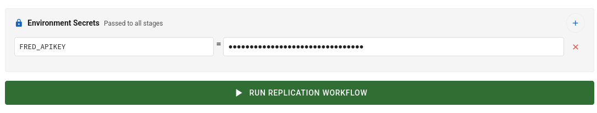

# TRACE FRED Example (SIVACOR)

This example is intended for use with https://submit.sivacor.org/ to demonstrate implementation of a TRACE System using the [tro-utils](https://github.com/transparency-certified/tro-utils/) toolkit.

This simple example is intended to demonstrate the following scenario:

> A researcher is preparing to submit a manuscript to a journal with strict transparency and reproducibility requirements. Their manuscript includes a plot of the S&P500 obtained using the Federal Reserve Economic Data (FRED) API. The FRED API terms of use prevent the author from sharing their private API key. The data underlying their plot is protected by copyright and S&P Down Jones, LLC, prohibits redistribution without permission.

It exercises the following SIVACOR features:

- [Handling of private API keys through environment variables](https://docs.sivacor.org/docs/step2-choosing-image/#advanced-settings)
- [Excluding files from final packages via `.sivacorignore`](https://docs.sivacor.org/docs/step0-prepare/#excluding-files-from-final-package)

To run this example:

- [Obtain a FRED API key](https://fred.stlouisfed.org/docs/api/api_key.html) and provide it as an environment variable named `FRED_APIKEY` in the SIVACOR submission form.

- Run with `rocker/tidyverse:4.5.2` or later on [SIVACOR](https://docs.sivacor.org/docs/step2-choosing-image/).
